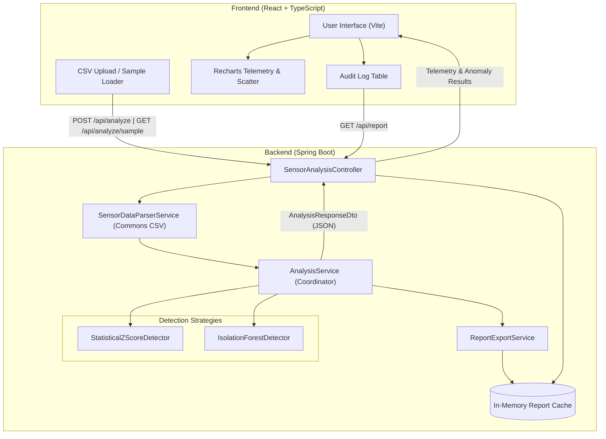

# Sensor Anomaly Detection System

An educational, full-stack telemetry monitoring and outlier detection platform built with **Java 17+ (Spring Boot)** and **React (TypeScript + Vite)**.

> **Disclaimer:** This project is an academic simulation designed for educational study, coursework, and technical interview demonstrations. It has not been tested on live defense systems, operational aerospace equipment, or military hardware.

---

## Table of Contents
- [Project Overview](#project-overview)
- [Key Features](#key-features)
- [Architecture & Data Flow](#architecture--data-flow)
- [Technology Stack](#technology-stack)
- [Project Structure](#project-structure)
- [Prerequisites](#prerequisites)
- [Installation & Setup](#installation--setup)
- [Running the Application](#running-the-application)
- [Example CSV Format](#example-csv-format)
- [REST API Documentation](#rest-api-documentation)
- [Automated Testing](#automated-testing)
- [Dashboard Preview (Placeholders)](#dashboard-preview)
- [Resume-Ready Project Description](#resume-ready-bullet-points)
- [Limitations & Future Roadmap](#limitations--future-roadmap)

---

## Project Overview

Modern telemetry systems across aerospace, maritime, and automotive domains continuously collect data from diverse sensor arrays (temperature sensors, pressure transducers, vibration accelerometers). Equipment failure is frequently preceded by subtle or abrupt anomalies in these telemetry channels.

The **Sensor Anomaly Detection System** provides an end-to-end environment to:
1. Ingest multi-sensor time-series CSV datasets securely.
2. Partition and normalize data across disparate physical measurement units.
3. Detect anomalies using two distinct algorithmic strategies:
   - **Parametric Statistical Baseline:** Population Z-Score ($|z| > \text{threshold}$).
   - **Unsupervised Machine Learning:** Isolation Forest tree ensembles (path length isolation).
4. Visualize readings interactively with contrasting anomaly highlights via Recharts.
5. Export verified anomaly audit reports as CSV files.

---

## Key Features

- **Multi-Sensor Independence:** Automatically partitions telemetry by sensor type (`temperature`, `pressure`, `vibration`) so each operates on its own physical baseline.
- **Dual Detection Strategies (Strategy Pattern):**
  - **Statistical Z-Score:** Mean ($\mu$), population standard deviation ($\sigma$), and configurable threshold (default: $2.0\sigma$).
  - **Isolation Forest:** Non-parametric ensemble of 100 Isolation Trees evaluating BST depth isolation scores ($0.0 \to 1.0$).
- **Interactive Recharts Dashboard:**
  - Continuous telemetry curve with distinct contrasting red anomaly scatter points.
  - Donut chart displaying nominal vs anomaly breakdown.
  - Bar chart showing anomaly counts across sensor categories.
- **Audit Table & Filtering:**
  - Filter by sensor type (`All`, `Temperature`, `Pressure`, `Vibration`).
  - Filter by status (`All`, `Anomalies Only`, `Normal Only`).
  - Search by timestamp, sensor name, or diagnostic rationale.
  - Page-by-page table pagination.
- **One-Click Built-In Sample Ingestion:** Immediate demonstration with realistic simulated telemetry without needing to prepare a CSV file.
- **Downloadable CSV Analysis Report:** Direct export of backend-verified results via `GET /api/report`.
- **In-Memory Thread-Safe Processing:** Zero temporary file creation on disk, ensuring safe, memory-bounded evaluation.

---

## Architecture & Data Flow



---

## Technology Stack

### Backend
- **Java:** Version 17+ (tested with Java 25 LTS).
- **Framework:** Spring Boot 3.3.5.
- **Build Tool:** Apache Maven 3.9+.
- **CSV Processing:** Apache Commons CSV 1.11.0.
- **Validation:** Spring Boot Bean Validation (Hibernate Validator).
- **Testing:** JUnit 5, Spring Boot Test, MockMvc, AssertJ.

### Frontend
- **Framework:** React 18 with TypeScript.
- **Bundler:** Vite 5.
- **Charting:** Recharts 2.12.
- **Icons:** Lucide React.
- **Styling:** Modern CSS3 with responsive CSS Grid and Flexbox layouts.

---

## Project Structure

```text
sensor-anomaly-detection/
├── backend/
│   ├── pom.xml
│   ├── src/
│   │   ├── main/
│   │   │   ├── java/com/sensordetection/
│   │   │   │   ├── SensorAnomalyDetectionApplication.java
│   │   │   │   ├── config/WebConfig.java
│   │   │   │   ├── controller/
│   │   │   │   │   ├── HealthController.java
│   │   │   │   │   └── SensorAnalysisController.java
│   │   │   │   ├── dto/
│   │   │   │   ├── exception/GlobalExceptionHandler.java
│   │   │   │   ├── model/
│   │   │   │   └── service/
│   │   │   │       ├── AnalysisService.java
│   │   │   │       ├── SampleDataService.java
│   │   │   │       ├── SensorDataParserService.java
│   │   │   │       ├── ReportExportService.java
│   │   │   │       └── detector/
│   │   │   │           ├── AnomalyDetector.java
│   │   │   │           ├── StatisticalZScoreDetector.java
│   │   │   │           └── IsolationForestDetector.java
│   │   │   └── resources/
│   │   │       ├── application.properties
│   │   │       └── sample/sensor_sample_data.csv
│   │   └── test/java/com/sensordetection/
│   │       ├── controller/SensorAnalysisControllerTest.java
│   │       ├── detector/StatisticalZScoreDetectorTest.java
│   │       ├── detector/IsolationForestDetectorTest.java
│   │       └── service/
│   │           ├── AnalysisServiceTest.java
│   │           └── SensorDataParserServiceTest.java
├── frontend/
│   ├── package.json
│   ├── tsconfig.json
│   ├── vite.config.ts
│   ├── index.html
│   └── src/
│       ├── types/sensor.ts
│       ├── services/api.ts
│       ├── components/
│       │   ├── Header.tsx
│       │   ├── MetricsOverview.tsx
│       │   ├── UploadControls.tsx
│       │   ├── TelemetryChart.tsx
│       │   ├── ReadingsTable.tsx
│       │   └── EducationalGuide.tsx
│       ├── App.tsx
│       ├── App.css
│       ├── index.css
│       └── main.tsx
├── sample-data/
│   ├── sensor_data.csv
│   └── high_noise_sensors.csv
├── docs/
│   ├── architecture.md
│   ├── testing.md
│   └── interview_guide.md
├── .gitignore
└── README.md
```

---

## Prerequisites

Ensure you have the following installed on your operating system:
1. **JDK 17 or later** (Java 17, 21, or 25).
2. **Apache Maven 3.8+** (or use the provided portable Maven path).
3. **Node.js 18+** and **npm 9+**.

---

## Installation & Setup

### 1. Clone or Open the Workspace

```bash
cd sensor-anomaly-detection
```

### 2. Backend Setup

```bash
cd backend
mvn clean compile
```

### 3. Frontend Setup

```bash
cd ../frontend
npm install
```

---

## Running the Application

### Step 1: Start the Spring Boot Backend

Open Terminal 1:

```powershell
# Windows PowerShell
cd backend
mvn spring-boot:run
```

The backend server starts on: **`http://localhost:8080`**.
Verify health by visiting: **`http://localhost:8080/api/health`**.

### Step 2: Start the React Frontend

Open Terminal 2:

```powershell
# Windows PowerShell
cd frontend
npm run dev
```

The frontend dashboard opens on: **`http://localhost:5173`**.

---

## Example CSV Format

Telemetry files uploaded through the dashboard or API must adhere to this standard format:

```csv
timestamp,sensorType,value
2026-01-01T09:00:00,temperature,24.1
2026-01-01T09:05:00,temperature,24.5
2026-01-01T09:10:00,temperature,24.3
2026-01-01T09:15:00,temperature,25.0
2026-01-01T09:20:00,temperature,62.8
2026-01-01T09:00:00,pressure,101.3
2026-01-01T09:05:00,pressure,101.5
2026-01-01T09:20:00,pressure,42.1
2026-01-01T09:00:00,vibration,0.031
2026-01-01T09:20:00,vibration,1.942
```

### Validation Rules
- **Header:** Mandatory columns `timestamp`, `sensorType`, `value` (case-insensitive).
- **Timestamps:** Non-blank string (ISO-8601 recommended).
- **Values:** Valid numeric float/double; non-finite numbers (`NaN`, `Infinity`) are rejected.
- **File Size:** Capped at 10 MB and 50,000 rows.

---

## REST API Documentation

| Method | Endpoint | Description | Request Parameters / Body | Response Status |
|---|---|---|---|:---:|
| `GET` | `/api/health` | Health check & supported algorithms | None | `200 OK` |
| `GET` | `/api/sample-data` | Retrieve built-in telemetry dataset as JSON | None | `200 OK` |
| `GET` | `/api/analyze/sample` | Execute analysis on built-in sample data | `threshold` (default 2.0), `detectorType` | `200 OK` |
| `POST` | `/api/analyze` | Ingest CSV file and run anomaly analysis | Multipart `file`, `threshold`, `detectorType` | `200 OK` / `400 Bad Request` |
| `GET` | `/api/report` | Download latest analysis report as CSV | None | `200 OK` (`text/csv`) |

### Example Error Response (JSON)

```json
{
  "success": false,
  "error": "BAD_REQUEST",
  "message": "Malformed CSV at line 4: Missing required column 'value'.",
  "status": 400,
  "timestamp": "2026-10-10T14:00:00.000"
}
```

---

## Automated Testing

Execute the comprehensive JUnit 5 test suite:

```powershell
cd backend
mvn test
```

All **23 unit and integration tests** pass, verifying:
- Population mean and standard deviation math.
- Identical value handling (zero variance $\sigma = 0.0$).
- Extreme spike detection.
- Isolation Forest tree depth and score computation.
- Malformed CSV rejection and HTTP status code verification.

---

## Dashboard Preview

```text
+-----------------------------------------------------------------------------------+
|  [~] SENSOR ANOMALY DETECTION SYSTEM     [Educational] [Isolation Forest] [Online] |
+-----------------------------------------------------------------------------------+
|  [ TOTAL READINGS: 30 ]  [ ANOMALIES: 3 ]  [ RATIO: 10.0% ]  [ MEAN: 41.34 ]     |
+-----------------------------------------------------------------------------------+
|  INGESTION & SENSITIVITY CONFIGURATION                                            |
|  [ Drop CSV Here ]  Strategy: [ Isolation Forest v ]  Threshold: [ 0.60 ]          |
|  [ Load Sample Telemetry ]  [ Download Analysis Report (CSV) ]  [ Reset ]         |
+-----------------------------------------------------------------------------------+
|  INTERACTIVE TELEMETRY STREAM & ANOMALY SCATTER                                   |
|  [All Sensors] [Temperature] [Pressure] [Vibration]                               |
|  Recharts Curve (Blue line) + Outlier Points (Contrasting Red Dots)               |
+-----------------------------------------------------------------------------------+
|  TELEMETRY AUDIT LOG (Page 1 of 3)                                                |
|  #   Timestamp            Sensor        Value    Score     Status    Rationale    |
|  1   2026-01-01 09:20:00  TEMPERATURE   62.800   0.7812    ANOMALY   iForest ...  |
+-----------------------------------------------------------------------------------+
```

---

## Resume-Ready Bullet Points

You may use these factual bullet points on your engineering resume:

- **Sensor Anomaly Detection System (Full-Stack Java & React):**
  - Engineered a full-stack telemetry monitoring platform using Java 17, Spring Boot, and React TypeScript to analyze multi-sensor time-series telemetry.
  - Implemented the Strategy Pattern to provide dual anomaly detection engines: a statistical population Z-Score baseline and an unsupervised Isolation Forest tree ensemble.
  - Developed robust CSV ingestion using Apache Commons CSV with input sanitization, non-finite numeric checks, and defensive memory constraints.
  - Built an interactive analytics dashboard featuring Recharts time-series scatter visualizations, dynamic sensor-partitioned filtering, and automated CSV report generation.
  - Authored a comprehensive test suite of 23 JUnit 5 and MockMvc integration tests verifying edge cases such as zero variance, payload limits, and API error contracts.

---

## Limitations & Future Roadmap

1. **Current Limitations:**
   - Evaluates static or uploaded CSV batches in memory rather than real-time sliding windows.
   - Evaluates sensor features independently rather than calculating cross-sensor correlations (e.g., rising temperature coinciding with sudden pressure loss).
2. **Future Enhancements:**
   - **Kafka / MQTT Streaming:** Ingest streaming sensor telemetry over WebSocket for live real-time charting.
   - **Multivariate Mahalanobis Distance / Autoencoders:** Model cross-sensor interdependencies across complex multi-variable operating states.
   - **Persistent Telemetry Store:** Introduce SQLite or PostgreSQL with TimescaleDB for historical telemetry archiving.
