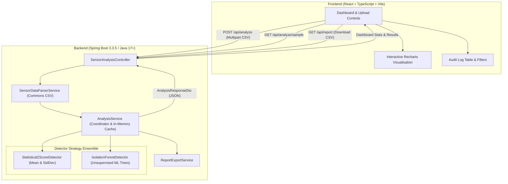

# System Architecture & Technical Design

## 1. Executive Summary

The **Sensor Anomaly Detection System** is an educational, full-stack telemetry analysis platform designed to ingest multi-sensor time-series datasets (temperature, pressure, vibration), identify unusual outliers using statistical and unsupervised machine learning methods, and visualize the findings through an interactive dashboard.

> **Educational Simulation Notice:** This application operates strictly on simulated sensor telemetry for educational, academic, and portfolio demonstration purposes. It does not interface with or claim validation on active defense or DRDO hardware systems.

---

## 2. High-Level System Architecture

The architecture follows a decoupled client-server model:



---

## 3. Data Flow & Processing Lifecycle

```mermaid
sequenceDiagram
    autonumber
    actor User as Engineer / Evaluator
    participant React as React Frontend
    participant API as SensorAnalysisController
    participant Parser as SensorDataParserService
    participant Engine as AnalysisService
    participant Detector as AnomalyDetector (Strategy)
    participant Cache as LatestReportHolder (Cache)

    User->>React: Select CSV or click "Load Sample Telemetry"
    React->>API: POST /api/analyze (file, threshold, detectorType)
    API->>Parser: parseCsv(InputStream)
    Note over Parser: Enforce UTF-8, validate headers,<br/>check numeric finiteness, limit records
    Parser-->>API: List<SensorReading>
    API->>Engine: analyze(readings, datasetName, detectorType, threshold)
    Engine->>Detector: detect(readings, threshold)
    Note over Detector: Partition by SensorType<br/>Evaluate Z-score or Isolation Forest
    Detector-->>Engine: List<AnomalyResult>
    Engine->>Engine: Compute aggregate metrics (Mean, PopStdDev, Anomaly %)
    Engine->>Cache: Store latest CSV report in memory
    Engine-->>API: AnalysisResponseDto
    API-->>React: HTTP 200 OK (JSON)
    React->>User: Render Dashboard, Charts, Scatter Highlights & Audit Table
    User->>React: Click "Download Analysis Report"
    React->>API: GET /api/report
    API->>Cache: Retrieve cached CSV
    API-->>React: HTTP 200 (text/csv; attachment)
    React->>User: Download sensor_anomaly_report.csv
```

---

## 4. Anomaly Detection Strategies

### Strategy A: Statistical Z-Score Detector (Baseline)
- **Paradigm:** Parametric statistical heuristic.
- **Formulas:**
  - $\mu = \frac{1}{N} \sum_{i=1}^N x_i$
  - $\sigma = \sqrt{\frac{1}{N} \sum_{i=1}^N (x_i - \mu)^2}$
  - $z = \frac{x_i - \mu}{\sigma}$
- **Decision Rule:** Flagged if $|z| > \text{threshold}$ (default: $2.0\sigma$).
- **Multi-Sensor Normalization:** Readings are grouped by `sensorType` so that temperature (°C), pressure (kPa), and vibration (g) do not distort one another.
- **Limitation (Masking Effect):** Extreme outliers distort both $\mu$ and $\sigma$, which can inadvertently mask secondary outliers.

### Strategy B: Isolation Forest (Unsupervised Machine Learning)
- **Paradigm:** Non-parametric ensemble algorithm (Liu, Ting, Zhou, 2008).
- **Core Concept:** Outliers are "few and different". In recursive binary partition trees (iTrees), anomalies are isolated closer to the root with fewer splits (shorter path lengths).
- **Tree Ensemble:** 100 random partition trees built to depth $\lceil \log_2(n) \rceil$.
- **BST Path Length Normalization:**
  $$c(n) = 2 \left( \ln(n - 1) + 0.5772156649 \right) - \frac{2(n - 1)}{n}$$
- **Anomaly Score:**
  $$s(x, n) = 2^{-\frac{E(h(x))}{c(n)}}$$
  - $s \to 1.0$: Definite anomaly (very short path length).
  - $s \approx 0.5$: Normal observation.
  - $s \to 0.0$: Deeply clustered nominal reading.

---

## 5. Security and Robustness

1. **No Filesystem Traversal:** Uploaded files are streamed and processed in memory; no temporary files are saved to disk, preventing arbitrary file writes.
2. **Filename Sanitization:** Client-supplied filenames are sanitized with regex `[^a-zA-Z0-9._-]` to prevent directory traversal or script injection.
3. **Payload Limits:** Multipart upload capped at 10 MB in Spring Boot configuration.
4. **Finite Number Validation:** `Double.isNaN` and `Double.isInfinite` checks prevent NaN-poisoning of floating-point computations.
5. **CORS Hardening:** Configured explicitly for local Vite development origins.
